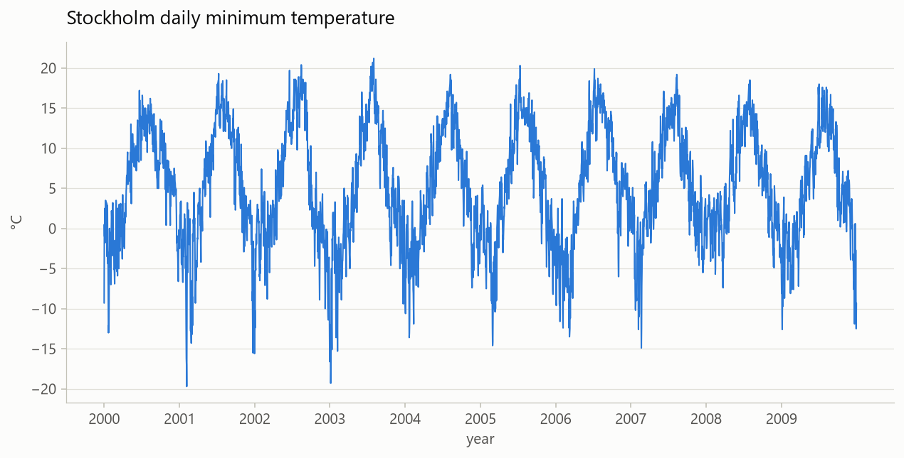
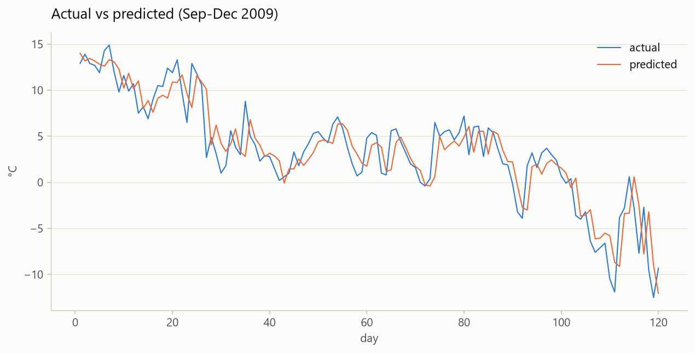
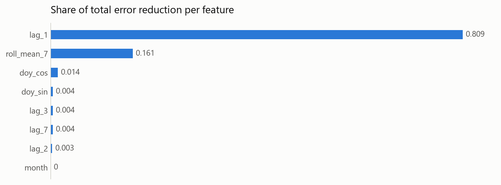

# Week 2 — Forecasting Tomorrow's Temperature with Gradient Boosting

A small, beginner-friendly **time-series** project using **gradient boosting**, a classical machine learning model.
It predicts tomorrow's minimum temperature in **Stockholm, Sweden** from the days before it.
Data: the [Weather prediction dataset](https://github.com/florian-huber/weather_prediction_dataset) on GitHub, built from ECA&D station data (CC BY 4.0 on Zenodo, MIT in the repo).
Every chart prints right in the terminal and is saved as a PNG in `results/`. The full explanation is in **[studyreport.md](studyreport.md)**.

```
weather-forecast/
├── data/stockholm-daily-min-temperatures.csv  from the GitHub dataset (downloaded automatically if missing)
├── models/                           saved models (created by step 4 and 6)
├── results/                          PNG charts (created by steps 1-5)
├── common.py                         shared helpers: download, clean, features, split, metrics, charts
├── step1_explore.py                  look at the data
├── step2_features.py                 data processing & transformation, train/val/test split
├── step3_gb_from_scratch.py          the algorithm in ~15 lines + a hand-checkable toy example
├── step4_train.py                    train with scikit-learn, validation picks the number of trees
├── step5_evaluate.py                 final test, baselines, residuals, feature importance
├── step6_improve.py                  tuning on validation, other booster, retrain, ideas
├── requirements.txt                  pinned library versions
└── studyreport.md                    the week's assignment report
```

## Setup (separate virtual environment for this project)

```powershell
cd weather-forecast
python -m venv .venv
.venv\Scripts\activate            # Mac/Linux: source .venv/bin/activate
pip install -r requirements.txt
```

## Run the steps in order

| Step | Command | What you learn |
|---|---|---|
| 1 | `python step1_explore.py` | The dataset, missing days, yearly cycle, autocorrelation |
| 2 | `python step2_features.py` | Lags, rolling mean, cyclic dates, time-based split |
| 3 | `python step3_gb_from_scratch.py` | The math of gradient boosting, by hand and in code |
| 4 | `python step4_train.py` | Training log, learning curves, over/underfitting, saving |
| 5 | `python step5_evaluate.py` | MAE / RMSE / R², baselines, error analysis |
| 6 | `python step6_improve.py` | Grid search, HistGradientBoosting, retraining (~35 s) |

**Result:** test MAE **1.63 °C**, compared with 1.68 °C for the "tomorrow = today" baseline (about 3% better; RMSE about 5% better).

Charts look best in a terminal at least 100 characters wide (VS Code terminal, Windows Terminal).

## Key charts

All 10 charts are in [`results/`](results/).

**The data:** a clear yearly cycle, with warm summers and cold winters.



**The forecast:** the model follows the general level but smooths out sudden jumps.



**What the model uses:** yesterday's temperature does most of the work.


